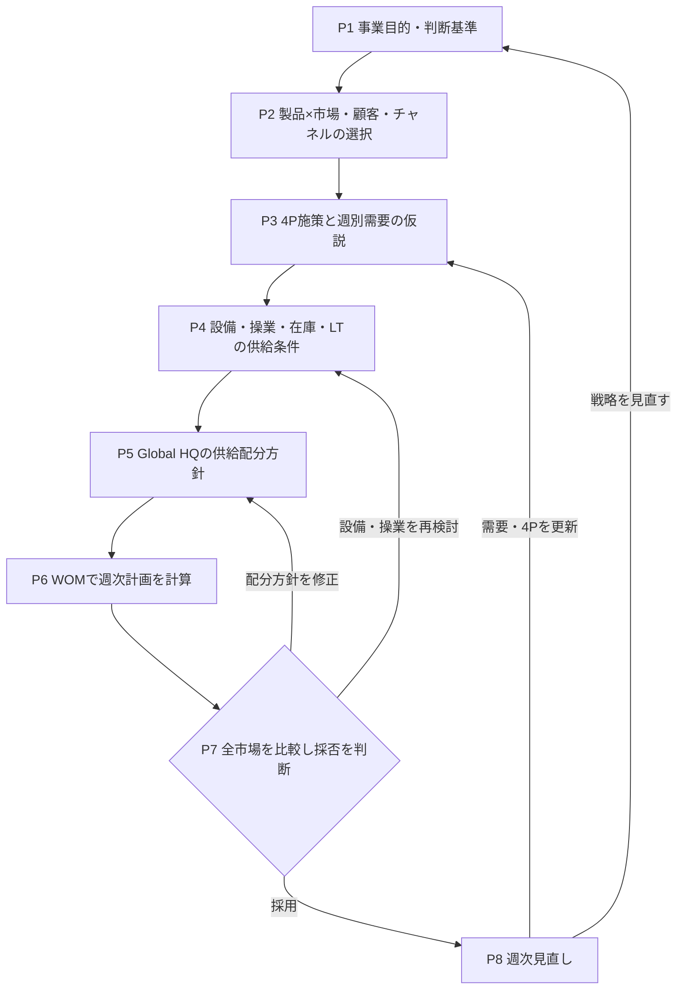
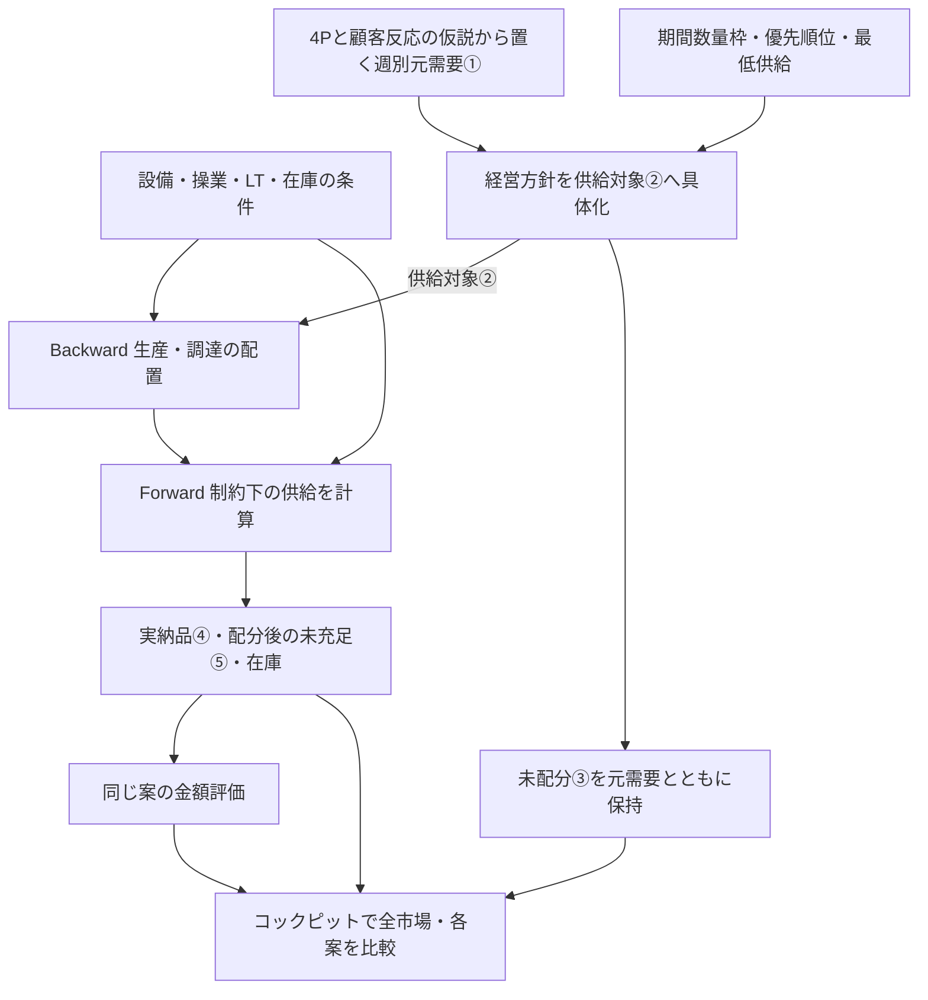

# 経営戦略からWOM経営コックピットへの業務プロセスフロー

- 版：v0.1
- 作成日：2026-11-18（日本時間）
- 状態：業務プロセス定義ドラフトを基にした構想図。採用・実装完了を示すものではない。
- 元資料：[戦略から週次供給までの業務プロセス定義 v0.1](https://chatgpt.com/library?file_id=libfile_2e0fcc627f2c8191b0254ffc588add4f&account_id=personal)
- 元資料の読取SHA：57cdfb45c7994ce63d10b43fd4a88ab7c7d91c00。これはGPT-MC君が記録した参照版であり、本図作成時にリポジトリを再確認したものではない。

経営が選んだ製品・市場・顧客・チャネルについて、4P施策と顧客反応の仮説から週別需要を置く。Global HQが供給方針を定め、WOMで生産・物流・在庫の制約下の結果を計算する。全市場への影響をコックピットで比較し、経営が採否と見直しを判断する。

P1〜P8は経営コックピットを使う側の業務プロセスである。BS-SEAFの開発・検証の8段階とは別の区分である。各業務と現行WOM機能の対応、未実装部分は、Claude君の設計照合で確認する。

## 図1 経営の判断と見直し

図1の戻り線は主要な見直し先を示す。戦略の変更は経営判断、配分の変更はGlobal HQの判断として扱う。期間数量枠と必須条件の衝突や納品未達を受けても、必須条件を無断で弱めて達成扱いにしない。

P8で実際の販売・生産実績を取り込む部分はTOBEに含まれる。計画シミュレーションの出力を実際の実績とみなさない。

## 図2 WOMの計画処理とコックピットへの接続

図2は論理的な情報の受け渡しであり、同名のモジュールやCSV列が実装済みであることを示すものではない。供給方針を需要へ反映する経路、Backward・Forwardとの接続、金額評価との対応を設計照合する。

金額評価には、採用した価格・費用・為替等の規則を使う。4Pによって需要だけでなく価格や販促費が変わる場合は、同じ案の前提として対応付ける。金額の未評価部分は0で埋めず、数量の評価と区別する。

④の「実納品」は、ここではForwardのシミュレーション上で実現した納品を指す。顧客への引渡しをどの地点で数えるかは、元資料と同じ受渡点でそろえる。

## コックピットに接続する情報

| 業務段階 | 入力・判断 | コックピットが扱う情報 |
|---|---|---|
| P1 事業目的 | 成長、事業継続、顧客接点、ブランド等 | シナリオの目的、評価期間、判断基準、許容する不利益 |
| P2 製品×市場 | 対象顧客、提供価値、重点市場の選択 | 製品×市場・チャネル表、市場分類、選定根拠 |
| P3 4P・需要 | 製品、価格、チャネル、販促と顧客反応 | 施策の条件、投入週、週別需要、価格・費用、想定の幅 |
| P4 供給条件 | 設備、操業、在庫、LT、品質 | 共通の比較条件と、条件を変えた案の差分 |
| P5 供給配分 | 期間数量枠、順位、同順位内ルール、下限 | 元需要①、供給対象②、未配分③、配分理由 |
| P6 週次計画 | Backward・Forwardで制約を反映 | 生産・調達・輸送・在庫、実納品④、未充足⑤、要求週との対応 |
| P7 比較・採否 | 戦略上の狙いと全市場への影響 | 市場別・期間別の供給、金額、在庫・年齢、条件衝突、採用理由 |
| P8 見直し | 更新予測、将来の実績情報、変更理由 | 版、旧案との差、残期間の目標、変更権限、上位判断への依頼 |

この表はTOBEの情報要件であり、新しい画面を八つ作るという指定ではない。

## 図を読む際の条件

1. **需要と優先順位を分ける。** 4P施策に対する顧客反応を需要仮説にし、不足時に何を守るかを供給方針として持つ。優先度を上げるだけで元需要を増やさない。
2. **配分と納品を分ける。** 同じ需要集合・単位・判定時点で、①＝②＋③、②＝④＋⑤を照合する。供給対象に残すことと、その時期に届けることは別に確認する。
3. **期間合計と要求週を分ける。** 今回の期間合計の目標とは別に、要求週別の未充足、遅配、供給ゼロの連続等を表示する。未採用の週次下限を追加しない。
4. **比較条件を分ける。** 初回は元需要・価格・費用・供給条件を固定して配分方針を比べる。4Pの変更で需要・価格・費用を変える比較は、その後の別案とする。
5. **経営の成果とシミュレーションの結果を分ける。** 供給条件への適合と、ブランド力や顧客関係の改善を区別する。利益・在庫の許容幅などが未決なら、差を表示し達否は未判定とする。
6. **業務役割と開発役割を分ける。** 経営・マーケティング・Global HQ・需給計画は利用側の役割である。GPT-MC君・Claude君・GPT君・Code君は、その業務を定義・設計・検証する開発側の役割である。

## 現行の醤油事例での段階的な確認

- R0：既存の21シフト案を再現する。
- R1：同順位の重要市場間の配分を週次計画につなぐ。JPの暫定保護等は未採用の条件として扱う。
- R1b：同じ期間数量枠で週への展開規則を比較する。
- R2：その他市場を含めた優先方針を確認する。現行サンプルにない市場の需要・経路は、明示した根拠に基づいて追加する。
- R3：4Pによる需要・価格・費用の仮説も変更し、施策と供給方針の影響を評価する。

本図は元資料の業務定義を図式化したものであり、新方針のシミュレーション、コード改修、GUI検証は実施していない。

