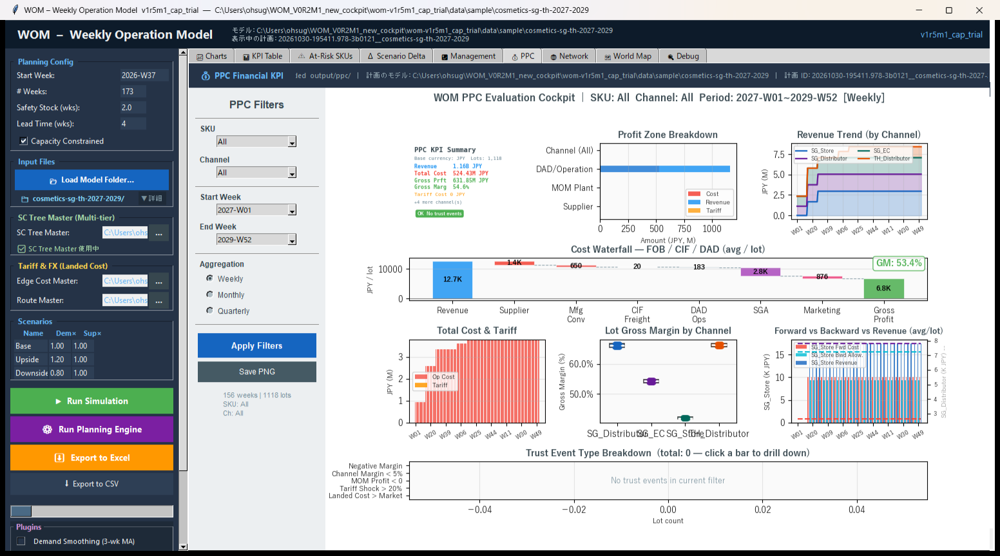
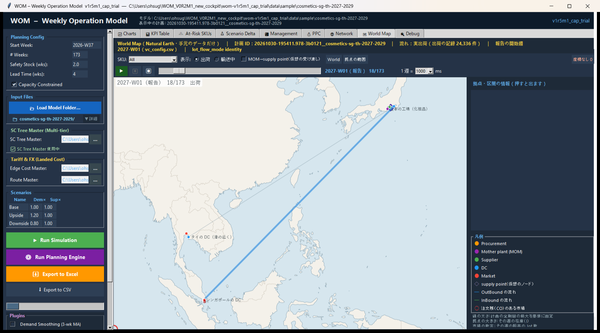
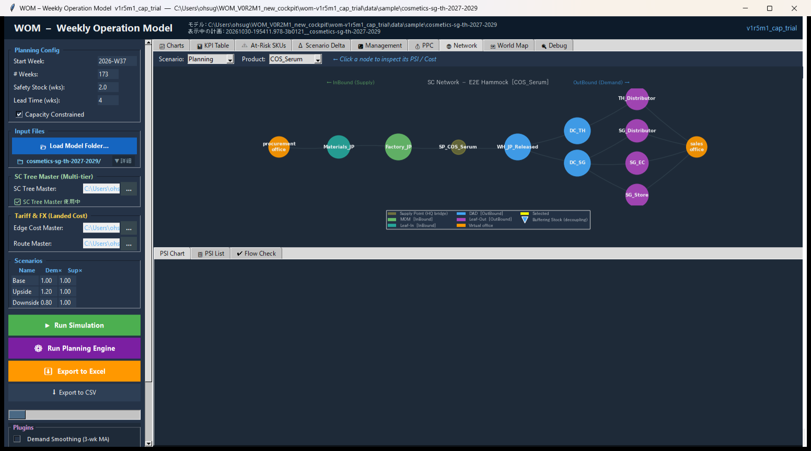
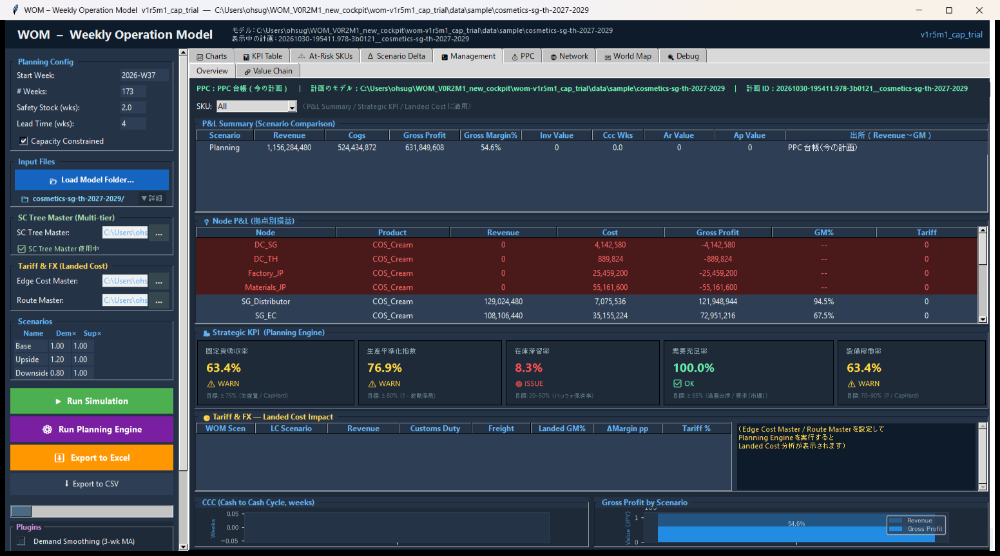

# 報告書：BS-SEAF 化粧品 — 採用モデルを正式なサンプルとして登録する（段階 6）

- 依頼：`requests/RequestLetter_BSSEAF_Cosmetics_RegisterSample_to_CodeKun.md` v0.2（2026-10-30）
- 実施：Code君（Claude Code）、2026-10-30
- 付録（再現用、git の追跡対象）：`docs/development/WOM_BSSEAF_Cosmetics_RegisterSample_appendix/`

## 0. 結論

**Code君の作業は完了。** 採用モデル M0 を `data/sample/cosmetics-sg-th-2027-2029/` に登録し、golden・README・シナリオの文書を足した。数量・PPC の結果は M0 とバイト単位で一致し、止める理由は無い。エンジン・道具のコードは変えていない。

| 区分 | 状態 |
|---|---|
| Code君の作業（S1〜S6、S8、S7 の道具での確認、S9 の案） | 完了 |
| S7 の最後の GUI の確認（依頼書 §4） | **Owner の確認待ち** |
| S9 の Start Here への実際の追記 | **索引の更新待ち（Claude君）** |

Value Chain は、既知の差を再現したことを確かめただけで、法人別・連結の損益が業務の要求を満たしたという判定は引き続き保留する。

## 1. 着手時の記録

- 着手時の SHA：`61f8a5b`（branch `wom-v1r5m1_cap_trial`。起草時の `e9741a6` の後に依頼書が commit された状態）
- 着手時の未追跡：`docs/design/drafts/Cosmetic_model/` だけ（この作業の前からある）
- 環境：Windows 11、Python 3.12.3（Anaconda）。`python` の既定は Windows Store の仮の実行ファイルだったので、`C:\Users\ohsug\anaconda3\python.exe` を明示した

## 2. 作ったもの

| もの | 内容 |
|---|---|
| `data/sample/cosmetics-sg-th-2027-2029/` | M0 の CSV 27 個（`README.md`・`_result/` は持ち込まず）、日本語の README |
| `tests/golden/cosmetics-sg-th-2027-2029.json` | 依頼書 §2.3 のコマンドで作成。legacy は作らない |
| `docs/scenarios/cosmetics.md` | シナリオの文書（英語）。比べる案の再現を含む |
| `docs/scenarios/README.md` | 一覧に 1 項目 |
| 付録 | 画像・記録・スクリプト |

金額の 10 ファイルは、M0 の付録 `money_csv/M0/` と 1 バイトも違わないことを確かめた。写した 27 個は元とハッシュが一致した。`planning_config.csv` は M0 のまま。共有の規則の宣言は置いていない。

## 3. 受入条件の結果

| # | 結果 | 内容 |
|---|---|---|
| S1 | 合格 | 入力は全部モデルのフォルダの中。実行は `output/` にも登録していないスクリプトにも依存しない。**ただし新しいファイルはまだ未追跡で、大杉さんの commit で git の管理下に入る** |
| S2 | 合格 | `run_headless_from_folder` で計画と PPC が動いた。期間 2026-W37 から 173 週、プラグインは M0 と同じ 3 つ、PPC は `評価済み` |
| S3 | 合格 | §3.1 |
| S4 | 合格 | §3.2 |
| S5 | 合格 | §3.3 |
| S6 | 合格 | §3.4 |
| S7 | 道具の確認は合格。最後は Owner | §3.5 |
| S8 | 合格 | README とシナリオの文書に、業務の意味・仮定・単位・実行の方法・期待する結果・既知の限界を書いた |
| S9 | 案を提出 | §6 |

### 3.1 S3 結果の再現

M0 の試行の出力と、登録したモデルの出力を比べた。**差は無い。**

| 出力 | M0 と比べた結果 |
|---|---|
| `flow_check_market.csv`（表2）、`flow_check_nodes.csv`（表1） | バイト単位で一致 |
| `ppc_event_ledger.csv`（18,200 事象）、KPI、チャネル × 週の記録など PPC の出力 7 ファイル | バイト単位で一致 |
| golden と M0 のスナップショット | `period`・`products`・`forward`・`backward`・`ppc`・`psi` が一致。違うのは `case` と `config`（`config` は M0 の記録にある別の項目） |

| 項目 | 値 |
|---|---|
| 需要 | 4,056 lot を全量、納期どおり。未充足 0 |
| 売上 | 1,156,284,480 円 |
| 費用 | 524,434,872 円 |
| 試算利益 | 631,849,608 円 |

8 通りの 1 個当たりの値は、台帳がバイト単位で同じなので M0 の報告書 T3 と同じ（README に表を載せた）。

**製品の年齢**：`tools.shelf_life_check --max-age-weeks 52` で、最大 6 週、52 週超 0。納品 4,056 lot のうち、直営店が 6 週、ほかのチャネルが 4 週。C3b の値と同じ。

### 3.2 S4 Value Chain

`tools.valuechain_run` は最後まで動いた。`--plugins` を渡さず、golden の組が既定で使われた。

`vc_ppc_comparison.csv` の「利益 合計（全期間、消去前）」、2026-W37〜2029-W52、JPY：

| PPC | 台帳 | 差 |
|---:|---:|---:|
| 631,849,608 | 935,061,504 | 303,211,896 |

期待値と一致した。差の内訳は SGA 235,225,692 ＋ 販促 67,986,204 ＝ 303,211,896（G1＋G2）。保存の検査は OK、issues 2,470 件。G1〜G5 は README に既知の限界として書いた。

### 3.3 S5 冪等

`wom.lovem.observer.model_hashes()` で、README を含む 28 ファイルの一覧と SHA256 を、実行の前後で比べた（記録：付録 `records/hashes_s5.json`）。

| 実行 | 前後 |
|---|---|
| CLI（`run_headless_from_folder`） | 同じ |
| CLI（`valuechain_run`） | 同じ |
| GUI（読み込み・計画・PPC） | 同じ |

README を足す前に、`shelf_life_check`・GUI の確認の道具 `gui_worldmap_check` の前後でも、CSV 27 個が同じことを確かめた。warmup の行は M0 に既に入っており、実行後の状態で登録し直す必要は無かった。既存の追跡しているファイルで変わったのは、意図した `docs/scenarios/README.md` だけ（`git status`）。

### 3.4 S6 回帰

`python -m tools.quick_check --full`：**992 passed、3 skipped、0 failed**（970 秒）。既存の golden（通常 15・legacy 3）と新しい golden、`test_public_readiness`・`test_no_real_names` はこの中で通った。既存の golden のファイルは変わっていない。3 skipped の理由は個別に見ていない。

### 3.5 S7 GUI

実アプリの窓で、モデルを読み込み、Run Planning Engine、PPC の完了まで自動で操作した（`scripts/gui_cosmetics.py`。既存の道具は画面ごとの画像を撮らないので、作業フォルダに置いた）。

- プラグインのチェックは読み込みで `recommended_plugins` の 3 つに合った
- 計画と PPC は 9.6 秒で完了。エラー 0
- `tools.gui_worldmap_check`：流れあり、出荷の記録 24,336 件、座標の欠け 0、エラー 0

画像（付録 `images/`）：









依頼書 §4 の 2（PSI の画面で、開店・店頭在庫・工場の平準化が見える）は、Code君は確かめていない。Owner の確認に残す。

## 4. 比べる案の再現（依頼書 §2.4）

`data/sample/` の写しに、シナリオの文書の手順だけを当てて 1 回たどった（`scripts/step3_repro.py`、記録 `records/repro_result.json`）。

| 案 | 結果 | 各報告書との照合 |
|---|---|---|
| C3a | ⑤ 192（美容液 TH 104、クリーム TH 88）。売上 1,119,737,280 円、試算利益 607,601,448 円 | 能力の CSV は C3a と 1 バイトも違わない。Flow Check 表1・表2 は M0a とバイト単位で一致 |
| M0t | 変えた行 2。関税 27,612,000 円、試算利益 604,237,608 円（M0 より 27,612,000 円少ない） | 台帳は M0t とバイト単位で一致 |
| P1 | ② 3,864、③ 192、④ 3,860、⑤ 4 | Flow Check は P1 の結果とバイト単位で一致 |
| P2-a1 | ② 3,864、③ 192、④ 3,860、⑤ 4 | 同上 |
| P2-a2 | ② 3,864、③ 192、④ 3,856、⑤ 8 | 同上 |

配分の案の金額は再計算していない（道具は `未評価`）。Flow Check が同じなので、P2-a の報告書の評価の額はそのまま使える。

## 5. 止める理由と申し送り

**止める理由：無し。**

申し送り（画面を見て分かったこと。README の既知の限界に書いた）：

1. **Management の Tariff & FX パネルが空**。`edge_cost_master.csv` が見出しだけのため。パネルには「Edge Cost Master / Route Master を設定して…」と出るが、ファイルは設定済みなので、メッセージと実際の原因がずれる。数字の誤りではない。
2. **Management の Inv Value・CCC・AR・AP が 0**。`sku_master.csv` に単価・回転日数が無いため。P&L の表に 0 が並ぶので「在庫が無い」と誤読しうる。
3. **PPC タブの Waterfall の GM は 53.4%、KPI と Management は 54.6%**。Waterfall は 1 lot 当たりの平均で、別の値。このモデルはチャネルの単価の差が大きいので、差が見える。
4. **Strategic KPI の警告**（在庫滞留率 8.3% ISSUE など）は、一般の目標値との比較。モデルの誤りとは確かめていない。

## 6. Start Here への追記の案（S9）

§4.1「手本にするモデル」の表（箇条書き）に 1 行：

```text
- **cosmetics-sg-th-2027-2029**：1 工場から 2 か国・4 チャネルへ、販売開始のずれ、店頭在庫、能力の平準化、製品の年齢の確認。比べる案（能力不足・数量配分）の作り方は docs/scenarios/cosmetics.md。
```

## 7. commit

下書き：`commit_msg155.txt`。git の操作は大杉さんが行う。
