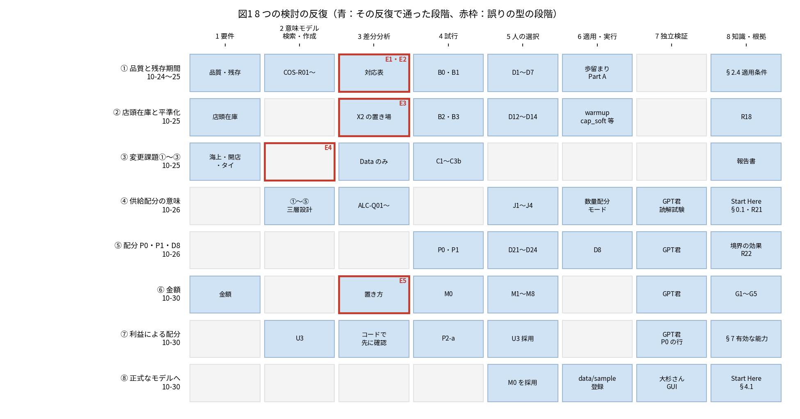
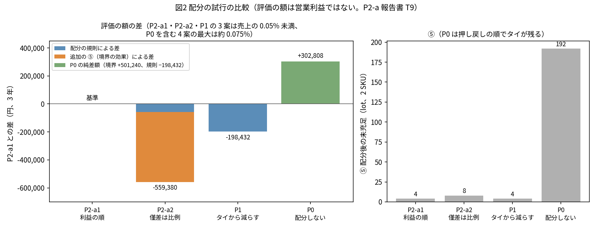

# BS-SEAF 検証報告 — 化粧品の事例（日本製高級スキンケアのシンガポール・タイ展開）

- 版：v0.2（2026-10-30）。GPT君のレビュー（`2ce9b3c` の v0.1 に対して）を反映
- 作成：Claude君（設計・Business Semantics Knowledge Curator）。判断：大杉さん（Business Semantics Owner）
- 骨組み：`requests/BSSEAF_Verification_Cosmetics_Report_Outline_v0.1.md`（v0.2）
- 対象の期間：2026-10-24（化粧品設計書 v0.1）〜 2026-10-30（正式なサンプルへの登録と GUI での確認）
- 根拠の版：`c2dcc27`（`wom-v1r5m1_cap_trial`）
- 数字は各報告書の値を写したもの。この報告では計算し直さない。出どころを〔 〕で示す
- 図：`WOM_BSSEAF_Verification_Cosmetics_Report_figures/`（`make_figures.py` で作り直せる）

---

## 要旨

1. **8 段階は、お米とは別の業務でも一通り実施できた。** 化粧品の事例では、8 つの検討の反復を通じて、全体として 8 段階を実施した（どの反復も全段階を通ったわけではない。図1）。最後の反復で採用したモデルを正式なサンプル（`data/sample/cosmetics-sg-th-2027-2029`）として登録し、通常の CLI・GUI で実行した。段階 6 は、教育・実証用のモデルの範囲で通った。
2. **誤りは 5 件、型は 3 つに分かれた。** 既存の知識を前提の外で使った（E1〜E3、段階 3）、知識はあったのに見つけられなかった（E4、段階 2）、既存の機能の能力を確かめる前に前提にした（E5、段階 3）。どれも、写しの試行か独立のレビューで見つかり、本番のモデルに入る前に止まった。
3. **更新した知識が、後続の設計判断と計測の方法に再利用された。** E4 の後に作った索引（Start Here §0.1）からの到達を、3 つの AI のセッションの読解試験で確かめた。E5 の教訓から、配分の基準（U3）を決める前に既存の配分の機能の能力をコードで先に確かめ、P2-a を選んだ。この二つは別の効果（索引の効果と、設計の手順の改善の効果）である。知識の更新だけによる改善の効果や、開発の生産性の向上の量は測っていない。
4. **数量と金額は、仮定のとおりに流れた。** 1 個当たりの損益は 8 通りとも期待値と一致し、登録したモデルは M0 の結果をバイト単位で再現した。配分の試行では、配分の基準の違いより、**計画の境界と週への需要の展開による未充足（⑤）の影響の方が大きい**ことが分かった。
5. **一つの事例から言えることには限りがある。** 一般化の候補を 4 つ挙げる（第6章）が、別の業務の事例と、経緯を知らない人間の読み手で確かめる必要がある。

---

## 第1章 検証の目的と範囲

**結論**：確かめたのは、BS-SEAF の手順が別の業務に使えるかどうかである。化粧品のモデルの完成や、業務で使える精度の金額は目的にしていない。

| 項目 | 内容 | 出どころ |
|---|---|---|
| 目的 | BS-SEAF の手順（Self-Evolving Modeling Loop の 8 段階）が、お米とは別の業務に使えるかを確かめる。お米で残した知識をどこで再利用できたか、新しい業務の意味のどれを Data・Parameter で表せ、どれが Core の話になるか、各段階の判断が根拠と検証の結果まで追えるか | 化粧品設計書 v0.5 §0.1 |
| 題材 | 架空の日本製高級スキンケアのシンガポール展開。2 SKU（美容液・クリーム）、3 チャネル（直営店・公式 EC・代理店）、日本の工場から海上輸送。途中でタイの代理店を足した。1 lot ＝ 1 ケース ＝ 24 個、計画は 2027〜2029 年の 156 週 | 同 §1、シナリオの文書 `docs/scenarios/cosmetics.md` |
| 役割 | 大杉さん（Business Semantics Owner、判断と GUI の確認）、Claude君（設計・Curator）、Code君（実装・実行の根拠）、GPT君（独立のレビュー）、Grok（読解試験） | 意味体系 README、各依頼書 |
| 範囲 | 段階 6 は「教育・実証用のモデルの正式な登録と実行」まで | 登録の依頼書 §0 |
| 範囲の外 | 実在の企業の値、業務に使える精度の金額、実企業での運用 | 金額の仮定 §0 |

金額は一般的な水準から置いた仮定である（M1〜M8）。試算利益は、歩留まりの損（約 3%）と日本本社の固定費を含まず、店舗の運営費を売上の 35% で近似している。グループの営業利益ではない〔M0 報告書、化粧品設計書 §8.7〕。

## 第2章 8 段階のループとの対応

**結論**：8 つの検討の反復を通じて、全体として 8 段階を実施した。反復の多くは段階 3（差分分析）の誤りか、段階 2（知識の検索）の失敗で戻っている。段階 6 は、最後の反復で正式なサンプルへの登録まで進んだ。

段階の名前は note の図（「Business Semantics-Driven Self-Evolving Application Framework」、[note 記事](https://note.com/osuosu1123/n/n19fad87014d1)）に合わせる。化粧品設計書の「第1〜3段階」は、図の段階 1〜3 に当たる。

| 段階（図の名前） | 化粧品で行ったこと | 主な成果物 | 担当 |
|---|---|---|---|
| 1. New Business Requirements | シンガポール展開、品質（歩留まり）、残存期間、店頭在庫、変更課題①〜③（海上 4 週・開店週・タイの代理店）、金額 | 設計書 §1・§5、金額の仮定 | 大杉さん |
| 2. Business Semantic Model Retrieval and Development | 既存の知識の再利用（設計書 §2.4）、意味モデル COS-R01〜R13、供給配分の意味体系（①〜⑤） | 設計書 §2、`docs/semantics/supply_allocation.md` | Claude君（GPT君のレビュー） |
| 3. Semantic Gap Analysis | WOM との対応表、中心の差分（品質・残存期間）、ALC-Q01〜Q10、Data／Parameter／Core の区別（図の Modification Points） | 設計書 §3、対応表 v0.2、U3 資料 §4 | Claude君 |
| 4. Trial Model Definition and Execution | 試行の写し（`output/bsseaf_cosmetics/`）：B0〜B3、C1〜C3b、P0・P1、M0、P2-a | 各試行の報告書 | Code君 |
| 5. Model Selection（Human Decision） | D1〜D25、J1〜J4、M1〜M8、U3 | 設計書 §6、対応表 §4、金額の仮定 §5.1、U3 資料 §6 | 大杉さん |
| 6. Model Application and Execution | 採用したモデル M0 を `data/sample/cosmetics-sg-th-2027-2029/` に登録し、通常の CLI・GUI で実行（golden・シナリオの文書・README、比べる案の再現の手順）。あわせて Core・道具の変更（歩留まり Part A、warmup の cap_soft、木の属性の空欄、`shelf_life_check`、数量配分モード、D8） | 登録の報告書、大杉さんの GUI での確認、各実装の報告書 | Code君・大杉さん |
| 7. Independent Validation | GPT君のレビュー（再計算、小さな再現、コードの確認）、読解試験（Claude Code・Grok・GPT君）、大杉さんの GUI での確認。独立性と検証の対象は §2.3 | レビューの記録、読解試験の結果 | GPT君・Grok・大杉さん |
| 8. Knowledge and Evidence Capture | 図の「Knowledge Base Update」の 4 種類：**Definitions**（意味体系）、**Applicability Conditions**（D7 の適用条件、warmup、境界の効果）、**Indexes**（Start Here §0.1・R20〜R22・落とし穴）、**Evidence**（報告書と付録、採否と根拠の二軸） | 意味体系、Start Here、報告書 | Claude君 |

### 2.1 段階 6：教育・実証用のモデルの範囲で通った

試行（段階 4）で選んだ（段階 5）M0 を、正式なサンプルとして登録した。受入条件 S1〜S9 を満たした〔登録の報告書〕。

| 確かめたこと | 結果 |
|---|---|
| 結果の再現 | Flow Check と PPC の出力が M0 とバイト単位で同じ。売上 1,156,284,480 円、試算利益 631,849,608 円、4,056 lot がすべて当週に届く、年齢の最大 6 週 |
| Value Chain | 既知の差 303,211,896 円（G1＋G2）を再現した。業務の要求は未完了のまま |
| 冪等 | CLI・GUI の実行の前後で、フォルダのハッシュが変わらない |
| 回帰 | 既存の golden は変わらない。`quick_check --full`：992 passed、3 skipped |
| 比べる案 | C3a・P1・P2-a・M0t を基準から一度たどり、各報告書の数と一致した |
| GUI（大杉さん、2026-10-30） | プラグインの組（Capacity Override・Buffering Stock・Holiday Calendar）。PSI で直営店の開店（2027-W14）、店頭在庫、工場の平準化。PPC は「評価済み」で、売上 1.156B・粗利 631.85M・GM 54.6%。World Map で日本 → シンガポール・タイの流れ |

これで、図の左側の 2 つの記憶（Business Semantic Knowledge Base と Application-Specific Models and Data Structures）の両方を更新したことになる。それまでに更新していたのは、主に前者と、Core・道具（後者の一部）だった。

段階 6 で、表示の誤読のおそれが 3 件見つかった：Tariff & FX の表示と原因の食い違い、単価が無いときの Inv Value・CCC の 0、同じ GM という名前で 53.4%（Waterfall）と 54.6%（KPI）の 2 つの値。これらは Start Here §7 の未解決の課題に入れた（第6章）。

### 2.2 検討の反復

| 反復 | 日付 | 主題 | 戻った所 |
|---|---|---|---|
| ① | 10-24〜25 | 品質と残存期間 | 試行 B0 で E1・E2 → 段階 3 の対応表に envelope と適用条件 |
| ② | 10-25 | 店頭在庫と平準化 | 試行 B3 で E3 → 段階 2・3 で年齢の数え方（先入れ先出し） |
| ③ | 10-25 | 変更課題①〜③ | C3a の後、レビューで E4 → 段階 2（知識の検索） |
| ④ | 10-26 | 供給配分の意味 | 段階 2 から作り直し：意味体系①〜⑤、三層設計 MD、数量配分モード、索引 |
| ⑤ | 10-26 | 配分 P0・P1、D8 | P1 の ⑤＝4 → 意味体系 §7 の境界の効果 |
| ⑥ | 10-30 | 金額 | 依頼書のレビューで E5 → 段階 3（PPC と Value Chain を分ける） |
| ⑦ | 10-30 | 利益による配分 | 基準（U3）をコードで確かめてから決めた。レビューで P0 の行 → §7 有効な能力 |
| ⑧ | 10-30 | 正式なモデルへ | 段階 5 → 6 → 7 → 8 |

### 2.3 段階 7：確認の活動ごとの独立性と、検証したもの

| 確認の活動 | 位置づけ | 検証したもの |
|---|---|---|
| Code君の受入条件・テスト | 実装者による自己検証・回帰の確認（独立ではない） | 数量・金額の結果の再現、既存の golden の不変、冪等 |
| GPT君のレビュー | 実装者以外によるレビュー。ただし GPT君も設計文書や依頼書の一部を作っており、設計全体からは独立していない | 文書・根拠の記録・図の生成コード、再計算、小さな再現、コードの確認。モデルやテストの再実行と GUI の確認は行っていない |
| 新しいセッションでの読解試験 | 索引から要る知識に辿り着き、意味を読み取れるかの確認。条件の差は §4.1 | 知識への到達と読解。計画の結果の数の検証とは別 |
| 大杉さんの GUI での確認 | 実装者以外による、通常の利用の経路での受入の確認 | 登録したモデルの読み込み・計画・PPC・World Map の表示 |

## 第3章 誤り E1〜E5 と、それによる知識の更新

**結論**：誤りは 3 つの型に分かれ、型ごとに打ち手が違った。どの誤りも本番のモデルに入る前に止まった。更新した知識が、後続の設計判断と計測の方法に再利用された例を確認した。本事例は、BS-SEAF の手順が機能したことを支持する。ただし、知識の更新だけによる改善の効果や、開発の生産性の向上の量は測っていない。

| 誤り | 型（図の段階） | 発見したもの | 更新した知識 | 更新が効いた後の判断 |
|---|---|---|---|---|
| E1 | 段階 3。前提の外で使った（お米の D7「期首在庫は先行生産で作る」を、供給の制約が無い所へ） | 試行 B0（在庫が全期間 0） | D7 に適用条件（設計書 §2.4） | 直接の後続の判断は示せない（適用条件を足したことの効果は未確認） |
| E2 | 段階 3。前提の外で使った（業務の定義の語 Production_Qty を、エンジンの既定 envelope＝hard へ） | 試行 B0 | envelope＝soft（D7）、COS-R11 と対応表に envelope | B2・B3 は定義どおりの計画で回った |
| E3 | 段階 3。前提の外で使った（需要の単位 Lot_ID を、物の個体へ） | 試行 B3（52 週超 195 と出た） | 年齢は先入れ先出しで数える（R18）、`shelf_life_check` | 以後の試行の年齢はすべて先入れ先出しで数えた。warmup 17 週の試行では最大 28 週（C3a 系）、warmup を 26 週へ延ばした C3a26 では最大 36 週。いずれも 52 週超 0 |
| E4 | **段階 2 の Retrieval の失敗**。知識はあったのに見つけられなかった（三層の配分経路） | GPT君・Codex の調査 | 意味体系、三層設計 MD、Start Here §0.1・R20・R21 | §3.1（索引からの到達） |
| E5 | 段階 3。既存の機能の能力を、確かめる前に設計の前提にした（Value Chain の売上の率の費用・MDF、`selling_cost`） | GPT君のレビュー | 依頼書を PPC の試行と Value Chain の観測に分けた。G1〜G5 を Start Here §7 に | §3.2（U3 資料 §4 で、既存の配分の機能をコードで先に確かめた） |

〔化粧品設計書 §8.2・§8.3・§8.5〕

**型ごとの打ち手**：

- **前提の外で使った（E1〜E3）**：知識に「いつ成り立つか」（適用条件）を付けて残す。三度続いたことで、意味モデルの項目に適用条件を持たせる必要が確かめられた。
- **見つけられなかった（E4）**：索引。業務の問いから意味体系 → 設計 MD → 事例へ辿る導線を Start Here に置く。
- **確かめる前に前提にした（E5）**：依頼書の「先に確かめること」を、置き方を決める**前に**設計者がコードを読んで確かめる。

E1〜E3 は、Mapping の表の上ではどれも「守れる」に見えていた。動かして初めて分かる差分であり、写しで試行してから適用する進め方（段階 4 → 5）が働いた。

### 3.1 知識の再利用 1：E4 → 索引 → 読解試験で到達を確認（BS-SEAF が機能したことを支持する根拠）

1. E4：C3a の後、「市場ごとの優先は WOM に無く、Core の課題」とした。実際には、三層の配分経路が既にあった。
2. 打ち手：三層設計 MD・供給配分の意味体系（①〜⑤）・Start Here §0.1（業務の問いからの導線）と R20。
3. 数量配分モード（R21、`tools/run_quantity_allocation.py`）を作った。金額を置かずに、人が lot の数量で配分を決める経路である。
4. 読解試験：3 つの AI のセッションで、Start Here からの到達を確かめた。Claude Code と Grok は経緯を渡さない条件で行った。GPT君は新しい会話で行ったが、事前の関与があり、同じ条件とは扱わない（第4章）。
5. P0・P1・P2-a で、その道具を使った。

### 3.2 知識の再利用 2：E5 の教訓 → U3 で既存の機能を先に調べる → P2-a を選ぶ

1. E5：金額の依頼書 v0.1 で、Value Chain の能力を確かめる前に前提にした。
2. 打ち手：置き方を決める前に、設計者がコードを読んで確かめる。
3. U3 の資料 §4 に「E5 の教訓：先にコードを確かめた」と書いた上で、既存の配分の機能（`wom/allocation`）を確かめた。`fixed_amount` しか読まない、通貨は JPY・USD・EUR だけ、能力は 1 つのプール、とわかった。
4. そこで、既存の機能を拡張する P2-b ではなく、小さな道具の P2-a を選んだ。

3.1 と 3.2 は別の効果である（索引の効果と、設計の手順を改善した効果）。一本につないで「索引が P2-a の選択を生んだ」とは言えない。

### 3.3 知識の再利用 3：期末の注文残の数え方（計測の方法）

1. 対応表 v0.1 の Q05 で、「期末の注文残は最終週の CO で数える」とした（誤り）。
2. GPT君の指摘で、Flow Check 表2 が要求の Lot_ID と実出荷を照合していることを確かめた。
3. 数量配分モードは、⑤ を表2 から Lot_ID で取る。
4. 以後、全試行で ⑤ を Lot_ID で照合した。P1 の ⑤＝4 の発見（境界の効果）は、この数え方があったから記録できた。

### 3.4 取り下げた記述

誤りとは別に、対話の中で Claude君が述べ、後に取り下げた記述が 3 つある〔設計書 §8.5〕。

1. 「warmup を能力の不足に使ってはいけない」：誤り。一時的な不足には、warmup を延ばす先行生産が正しい打ち手である。
2. 「配分で誰を待たせるかを決める」：配分と納期延期を混ぜた表現。配分は供給対象の数量を決める判断で、納期を変えない。
3. 「年間の配分」：配分の数量は対象期間（化粧品は 156 週）について決める。

ほかに、金額の試行では次の 2 つを推奨の段階で直した：日本本社の費用を売上の率で置く推奨（→ 週の固定の予算。売上の率はグループ内のロイヤルティにだけ合う）、タイの関税の感度の見込み 1,821 円（→ 実際は 1,800 円。PPC は振替価格だけに課税する。G4 として記録）。

## 第4章 知識の引き継ぎ

**結論**：意味・WOM との対応・事例を分けて書く形と、採否と根拠の二軸で、知識を残せた。経緯を渡さない条件の 2 つの AI（Claude Code・Grok）を含め、索引から辿れることを確かめた。ただし試験の作り方には限界がある。

| 項目 | 内容 | 出どころ |
|---|---|---|
| 構成 | 意味（`docs/semantics/`）・WOM との対応（設計 MD）・事例（設計書・報告書）を分けて書く。各記述に、採否（提案／採用／保留／廃止）と根拠（未確認／文書確認／コード確認／実行確認）の二軸 | `docs/semantics/README.md` v0.2 |
| 供給配分の意味体系 | ① 元の需要、② 配分後の需要、③ 未配分、④ 実納品、⑤ 配分後の未充足。①＝②＋③、②＝④＋⑤ は同じ需要の集合・同じ判断の時点・同じ単位（lot）でだけ成り立つ。§7 境界の効果と有効な能力。未決 U1〜U4（U3 は化粧品の事例で採用、U4 は保留） | `docs/semantics/supply_allocation.md` |
| Start Here | §0.1（業務の問いからの導線）、R20〜R22、落とし穴 8・12、§4.1 の手本のモデルに化粧品、§7 の未解決の課題 | `docs/WOM_Start_Here.md` |

### 4.1 読解試験

条件：Start Here だけを渡し、供給配分についての 10 の問いに答えてもらう〔`requests/BSSEAF_IndexReadingTest_v0.1.md`〕。Claude Code と Grok は経緯を渡さない条件。GPT君は新しい会話だが、この知識の整備のレビューを担当していたので経緯に触れており、同じ条件とは扱わない〔GPT の読解試験の記録の冒頭〕。

| 読み手 | ○ | △ | × | E4 に関わる問（3・4(b)・5・8） |
|---|---:|---:|---:|---|
| Claude Code（新しいセッション） | 10 | 0 | 0 | すべて ○ |
| Grok | 9 | 1 | 0 | すべて ○ |
| GPT君 | 9 | 1 | 0 | すべて ○ |

〔`docs/development/WOM_IndexReadingTest_*_20261026.md`〕

- 3 つとも §0.1 の表の順（意味体系 → 三層設計 MD → 対応表・報告書）に迷わず辿った。E4 への打ち手は効いている。
- 問 10 の △ は、意味体系の未決（U1〜U4）と事例の未決（化粧品設計書の H9・H10 など）が別の文書にあるため。問いの書き方の問題で、索引の直しは要らないと判断した。
- 試験で古い記述が見つかり、直した（変更課題①〜③の報告書 §4.2 に訂正の注記など）。

**限界**：GPT君は経緯に触れている。問いは Claude君が作った（索引を作った者が試験も作った）。試験の後に知識を足しており（金額・U3・境界の効果の続き・化粧品のサンプル）、今の版では試していない。

## 第5章 数量と金額の検証の結果

**結論**：数量（①〜⑤、年齢）と金額（1 個当たりの損益）は、仮定のとおりに流れた。外れた見込みは 2 つで、どちらも計画の境界の効果による。③ 未配分と ⑤ 配分後の未充足は、別々に記録できた。

| 試行 | 期待 | 実績 | 残った差 | 出どころ |
|---|---|---|---|---|
| B0・B1 | 開店時の在庫が warmup でできる | B0 と B1 は同じ計画。在庫は全期間 0 | E1・E2 | Trial 報告書、設計書 §8.1 |
| B2・B3 | 店頭在庫、平準化、歩留まり 0.90 で年齢が延びる | 店頭在庫は Serum 8・Cream 6 lot。B3 で 52 週超 195 と出たが数え方の誤り | E3（先入れ先出しで最大 16・19 週） | Trial B2 報告書、設計書 §8.3 |
| C1〜C3b | Data の変更だけで表せる | 新しいファイル・列・Core の変更なし。C3a は ⑤ 192（タイの 2029 年）、C3b は 0 | E4、取り下げた記述 | ChangeTasks123 報告書、設計書 §8.4 |
| P0・P1 | P1 の ⑤＝0 | ⑤＝4（各 SKU 2、境界の効果） | 能力 2,184 → 有効 2,182 | P0P1 報告書、設計書 §8.6 |
| M0 | 8 通りの 1 個当たりの損益 | 一致。売上 1,156,284,480 円、試算利益 631,849,608 円。M0t 利益 −27,612,000 円、M0a 売上 −36,547,200 円 | Value Chain の G1〜G5（差 303,211,896 円） | M0 報告書、設計書 §8.7 |
| P2-a | 規則の差 −58,140 円 | −559,380 円（境界の ⑤ が −501,240 円） | P2-a1 は P1 より 198,432 円良いが、P0（配分しない）に 302,808 円届かない | P2-a 報告書 T9、設計書 §8.8 |
| 登録（段階 6） | M0 と同じ結果 | Flow Check・PPC の出力がバイト単位で一致、年齢の最大 6 週、Value Chain の差を再現、比べる案を基準から再現 | 表示の誤読のおそれ 3 件 | 登録の報告書 |

### 5.1 配分の試行：③ と ⑤ を分けて見る

| 案 | ③ 未配分（減らした代理店、美容液／クリーム） | ⑤ | 評価の額（円） | P2-a1 との差 |
|---|---|---|---:|---:|
| P2-a1（利益の順） | シンガポール 104／88 | 各 SKU 2 | 607,298,640 | — |
| P2-a2（僅差は需要に比例） | タイ 32・SG 72／タイ 25・SG 63 | 各 SKU 4 | 606,739,260 | −559,380 |
| P1（タイから減らす） | タイ 104／88 | 各 SKU 2 | 607,100,208 | −198,432 |
| P0（配分しない） | なし | 104／88（押し戻しの順でタイ） | 607,601,448 | ＋302,808 |
| C3b（能力を足す） | なし | 0 | 631,849,608 | ＋24,550,968 |

〔P2-a 報告書 T9。評価の額 ＝ Σ 届いた個数 × 1 個当たりの貢献利益 − 固定費の相当額 213,719,220 円（M0 から凍結）。営業利益ではない〕

読み方：

1. **配分の方針の効果は小さい。** P2-a1・P2-a2・P1 の 3 案の差は売上の 0.05% 未満（P0 を含む 4 案の最大の差は約 0.075%）。変わるのは、貢献利益がほとんど同じ代理店の間だけである（1 個 30 円、0.5%）。どの代理店を減らすかは、利益より業務の判断（タイという新しい市場の意味、代理店との約束）で決まる種類の問題である。タイの関税が 30% なら、どちらの規則も P1 と同じ配分になる。
2. **週への需要の展開と計画の境界による ⑤ の影響の方が大きい。** P2-a2 の差のうち、規則による差は −58,140 円だけで、残りの −501,240 円は ⑤ が各 SKU 2 lot 増えた分である。最初の週は原料の区間で作れず、最後の 2 週は余裕を埋める需要が無い。未充足の原因は計画の境界と週への需要の展開にあり、実業務の供給不足とは断定しない。ただし、モデル上の未充足と評価の額への影響は、結果として残す。
3. **配分しない P0 の方が、評価の額が大きかった。** P2-a1 との差 ＋302,808 円は、境界による差 ＋501,240 円（P1 との差。届いた量は P1 の配分と同じで、境界の ⑤ が無い）と、配分の規則による差 −198,432 円（P1 と P2-a1 の差）の合計である。配分の目標を能力の名目の合計にそろえると、境界で使えない能力の分だけ届く量が減る。配分の目標は有効な能力で決める（意味体系 §7）。ただし P0 で何が届かないかは押し戻しの順で決まり、業務の判断ではない。

## 第6章 一般化と次の課題

**結論**：共通の仕組みの候補は 4 つある。どれも一つの事例・一週間の範囲でしか確かめていない。次は U4 を決め、その後に Value Chain の拡張か固定費のどちらかに進む。

### 6.1 今回から抽出できる共通の仕組みの候補（汎用の Core Package に向けて）

| 候補 | 今回確認できた範囲 | 別の業務の事例で確かめる必要があること |
|---|---|---|
| 意味と適用条件の管理（定義・採否・根拠の二軸） | 供給配分の 1 領域 | 別の領域（品質、金額）でも同じ形で書けるか |
| 既存の機能への索引（Start Here からの導線） | 読解試験で 3 つの AI のセッションが辿れた（うち経緯を渡さない条件は 2 つ） | 経緯を知らない人間、別のリポジトリ |
| 判断と検証の結果の追跡（D・J・M・U の番号、報告書の止める理由と申し送り） | 化粧品の 1 事例、1 週間 | 判断の数が増えたときに追えるか |
| 設計の前提をコードで先に確かめる手順（E5 の打ち手） | U3 資料で 1 回 | 繰り返して効くか |

### 6.2 化粧品に固有の仮定

金額の仮定（M1〜M8）、店舗の運営費の近似（売上の 35%）、タイの関税（EPA で 0% と仮定。一般の税率は CIF に 30%、未確認）、U3 の採用（化粧品の事例に限る）。

### 6.3 未検証のこと

- 別の業務への適用
- 実企業での運用（段階 6 は教育・実証用の範囲）
- 人間の読み手による読解試験。試験の後に足した知識での再試験
- Value Chain の金額の層（G1：売上の率の費用、G2：代理店のノードの費用、G3：売上の週、G4：関税の課税価格、G5：CIF の運賃の負担）
- 固定費（F 型。`ppc_period_cost_rule` の案）
- GUI の表示の誤読のおそれ 3 件（段階 6 で発見。Start Here §7）

### 6.4 次の課題の順

1. **U4**：対象期間の配分の数量を、各週の需要にどう当てるか。業務の方針を先に決め、その後に配分のファイルに週の列を持たせるかを決める。第5章の読み方 2 のとおり、今回いちばん影響が大きかったのはここである。
2. 次にどの経営判断を可能にしたいかに応じて、**Value Chain の拡張（G1〜G5）** か **固定費（F 型）**。
3. 表示の誤読のおそれ 3 件は、上と並行して小さく直せる。

---

| 版 | 日付 | 内容 |
|---|---|---|
| v0.1 | 2026-10-30 | 本文の初版（骨組み v0.2 に沿う）。GPT君のレビューの前 |
| v0.2 | 2026-10-30 | GPT君のレビューを反映：段階 7 を確認の活動ごとの独立性と検証の対象で書き分け（§2.3）、読解試験の条件の差、第3章の結論を「支持する」に弱め、索引の効果と手順の改善の効果を分けた、「8 周」を「8 つの検討の反復」に、E3 の年齢に C3a26（最大 36 週）、図2 の P0 の内訳と 0.05% の対象 |
